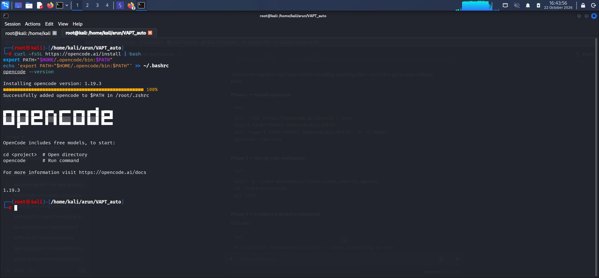
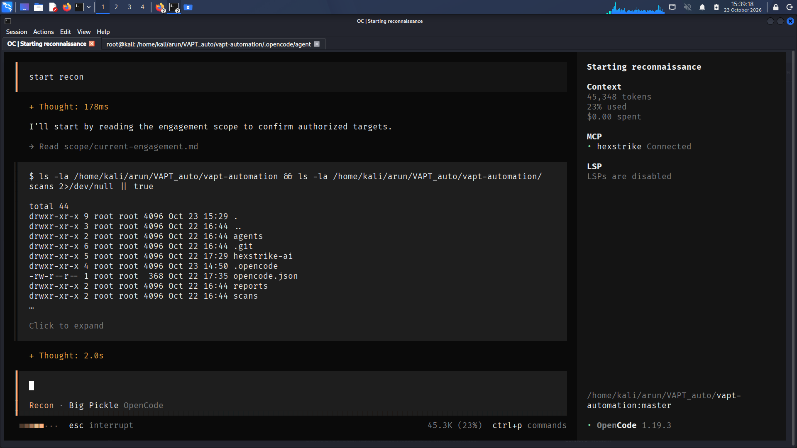
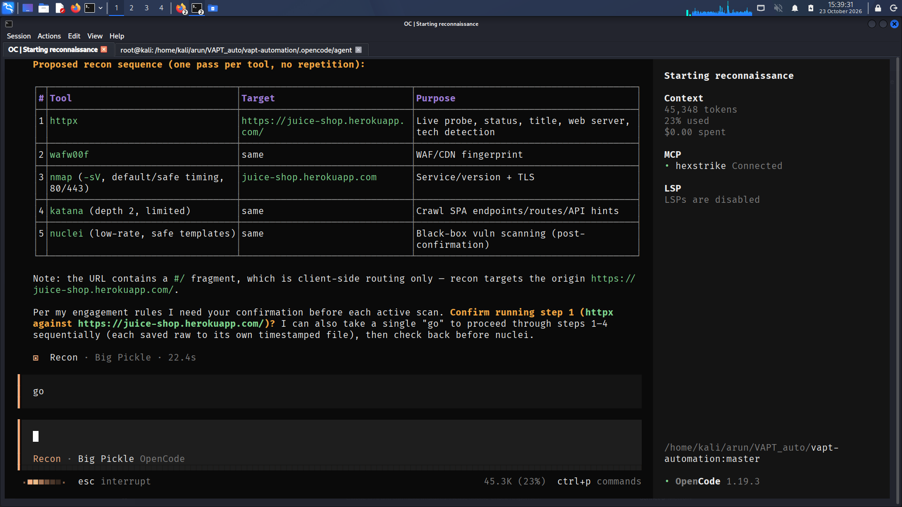
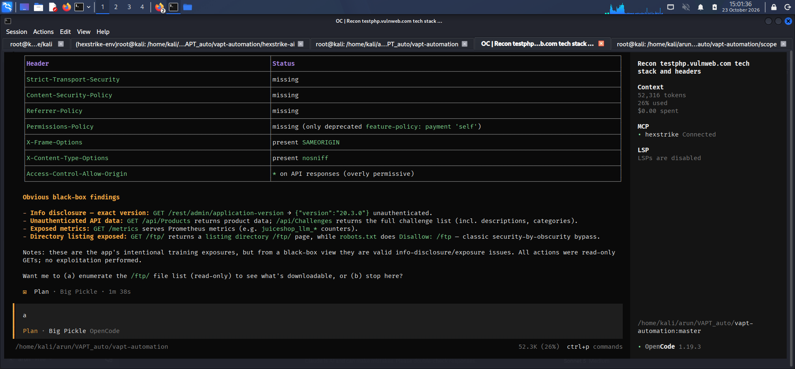
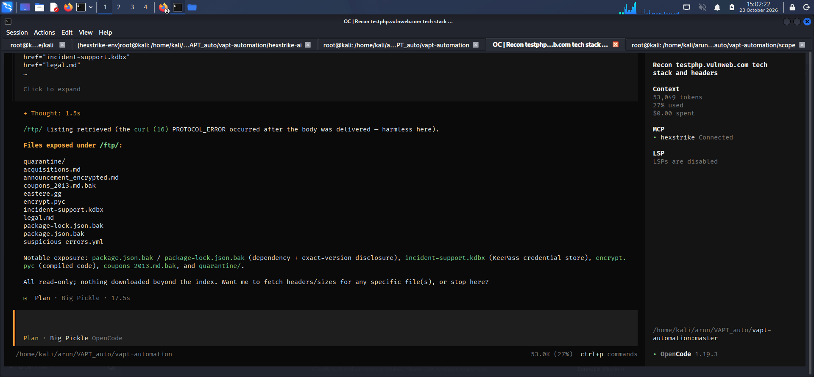
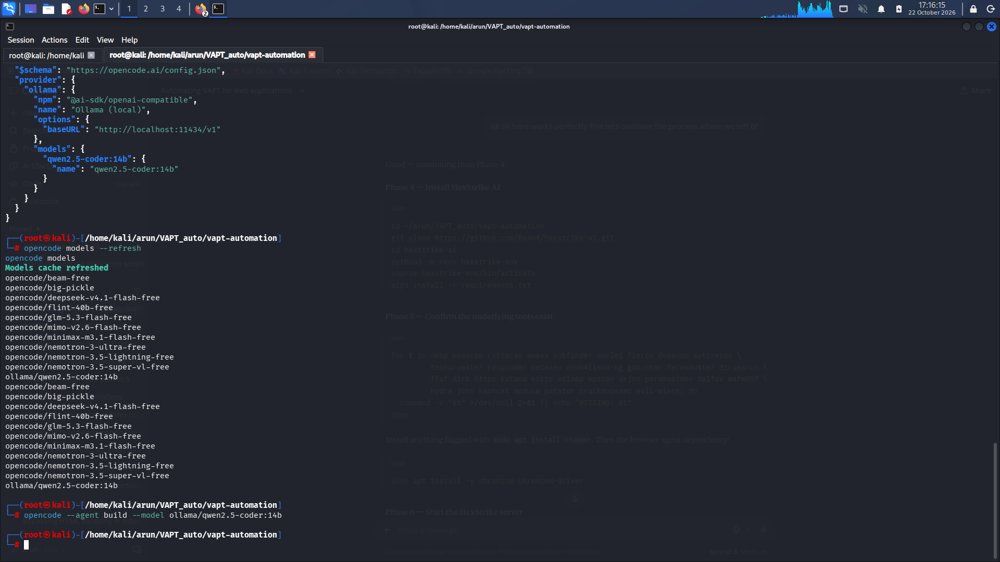
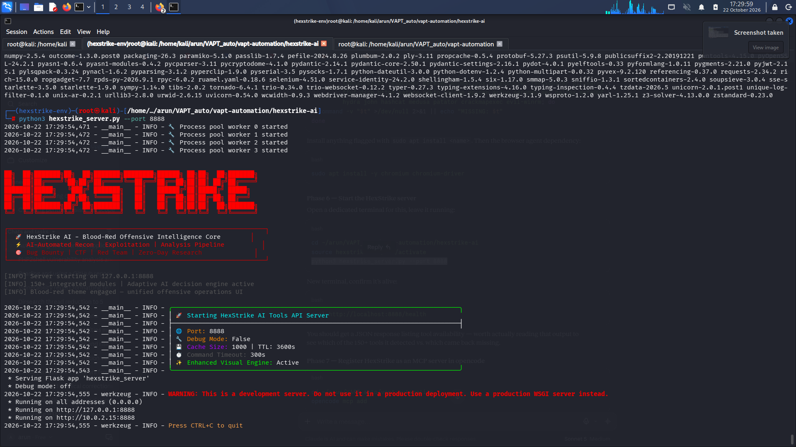
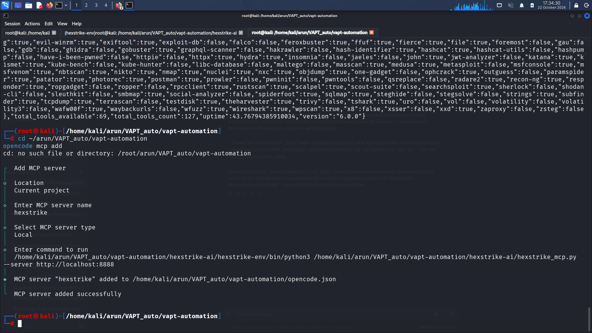

# VAPT Automation — opencode + HexStrike AI

An automated web application penetration testing pipeline: a local AI agent (opencode) connected to HexStrike AI's 150+ security tools via MCP, running fully on your own machine.

## Requirements — read this first

- **Kali Linux only.** This project is built and tested specifically on Kali. It has NOT been tested on Ubuntu, Debian, or other distros — the install script checks for Kali and will warn you if you're on something else.
- Minimum ~8GB RAM recommended (less is possible but will be slow — see "Choosing a model size" below).
- An internet connection for the initial install (fully offline-capable afterward if using a local model).

## Why we use smaller AI models by default

This project can run entirely offline using a local model via Ollama — no API costs, no data leaving your machine. The tradeoff: local models need to fit in your available RAM, and a larger model (better reasoning, better judgment on what to test and how to interpret results) needs much more RAM than a smaller one.

The install script detects your actual available RAM and recommends a model size accordingly — but it always asks you to confirm, rather than deciding for you. If you have 16GB+ RAM, you can and should use a larger model (14b or above) for noticeably better results. If you're on a constrained VM (under 8GB), a smaller model (3b/7b) will actually run reliably instead of crashing.

## What's in this repo

- `install.sh` — automated setup: checks your OS, detects your hardware, installs opencode + Ollama + HexStrike AI + required security tools
- `start.sh` / `stop.sh` — daily startup/shutdown scripts
- `agents/` — two ready-to-use agent configurations:
  - `pentest-client.md` — for formal, contracted pentest engagements (black/grey/white box)
  - `bugbounty.md` — for bug bounty programs: black-box first, zero brute force, deep Broken Access Control coverage, waits for you to confirm scope before acting
- `scope/` — example scope templates (fill these in with YOUR actual engagement/program details — never commit real scope data)
- `doubts/` — every real issue we hit while building this, and how we fixed it. Read this before asking "why isn't X working" — it's probably already answered here.
- `screenshots/` — visual walkthrough of the setup working

## Quick start

See [INSTALL.md](INSTALL.md) for the full step-by-step guide.

## Screenshots

*opencode installed and ready to go.*

*The agent reads scope/current-engagement.md at the start of every session before doing anything else.*

*The agent proposes a tool sequence and explicitly asks for confirmation before running any active scan.*

*Example findings against testphp.vulnweb.com, a publicly sanctioned practice target.*

*Agent discovering exposed files during black-box recon.*

*Local model successfully connected and available to opencode.*

*HexStrike's MCP-connected tool server coming online.*

*HexStrike registered as an MCP server inside opencode.*

## Safety notice

This tooling can run real, active security tests. Only use it against targets you own, have explicit written authorization to test, or that are publicly designated for security testing practice (e.g. OWASP Juice Shop, Acunetix's vulnweb.com test sites). Review `agents/bugbounty.md` and `agents/pentest-client.md` — both are written to ask for confirmation before active/destructive actions, but you are responsible for what you authorize it to do.
